# Enterprise ERP Monorepo Architecture & Modular Core

A production-grade foundation for multi-tenant business systems: a **NestJS API** and an **Angular PWA** in a
single pnpm monorepo, built on **hexagonal architecture** that the linter enforces, with sessions,
role-based permissions, an immutable audit trail and a per-client deployment model already in place.

The core is deliberately **business-agnostic**: no industry tables, rules or wording live in it. Each vertical
(accounting, inventory, capital markets…) is built as its own module on top.

> **Language note.** Identifiers, API messages and internal docs are in **Spanish** by design (the target users
> are Spanish-speaking; see *Conventions*). Architecture suffixes and framework terms stay in English
> (`*.use-case.ts`, `*.port.ts`, `*.controller.ts`).

<p align="center">
  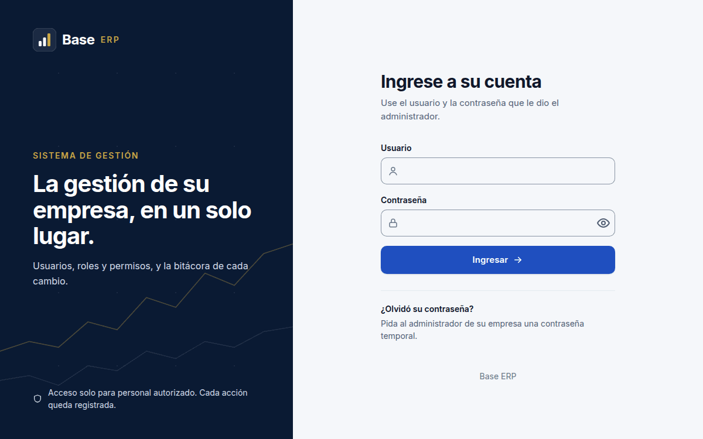
</p>
<p align="center"><sub>Sign in → open a role → grant a permission → the change appears in the immutable audit log, with before / after.</sub></p>

---

## Screenshots

<sub>All names and data are fictitious demo data. The brand ("Base ERP") is a placeholder that each product replaces in one place.</sub>

| | |
|---|---|
| 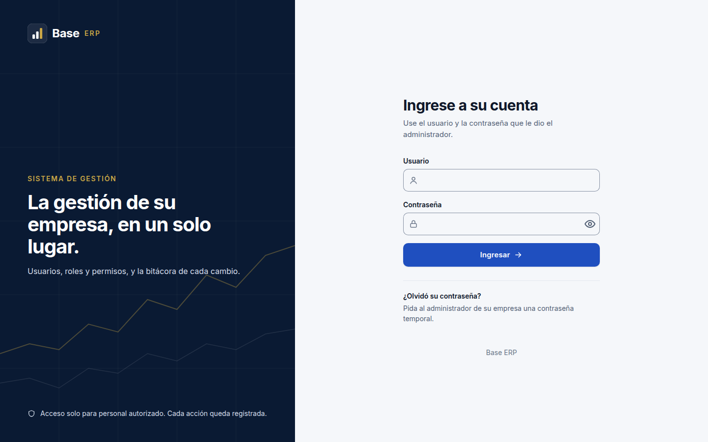 **Sign-in** — session with in-memory access token and `httpOnly` refresh cookie | 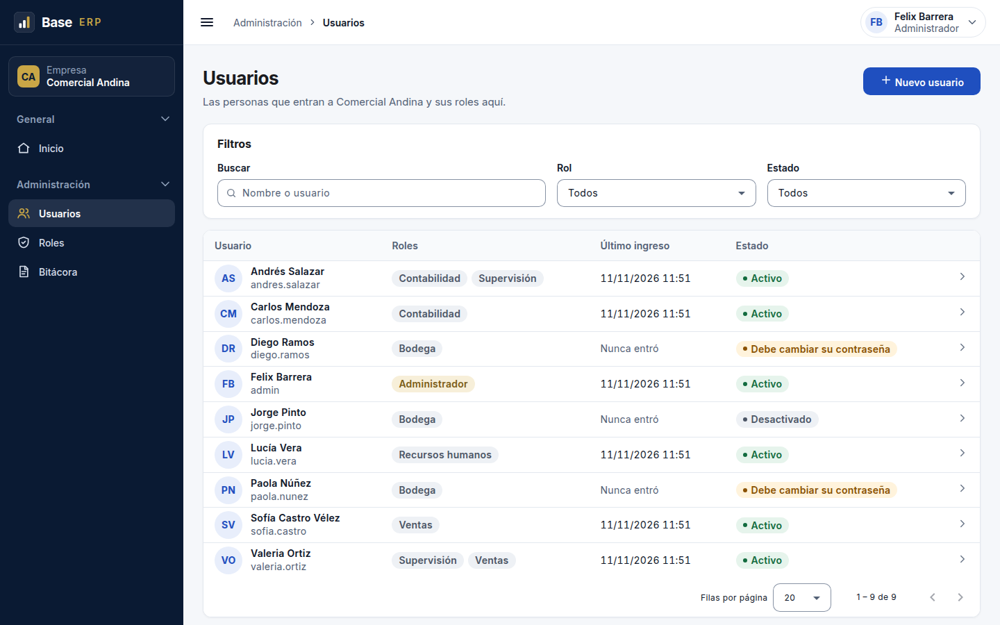 **Users** — filters and paging kept in the URL, status and last sign-in |
| 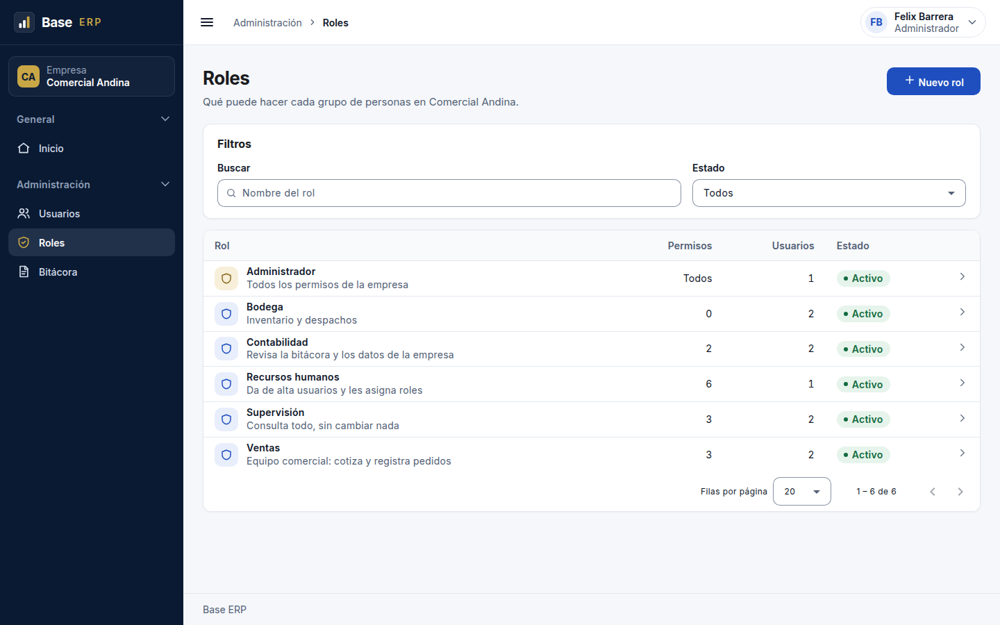 **Roles** — configurable per company | 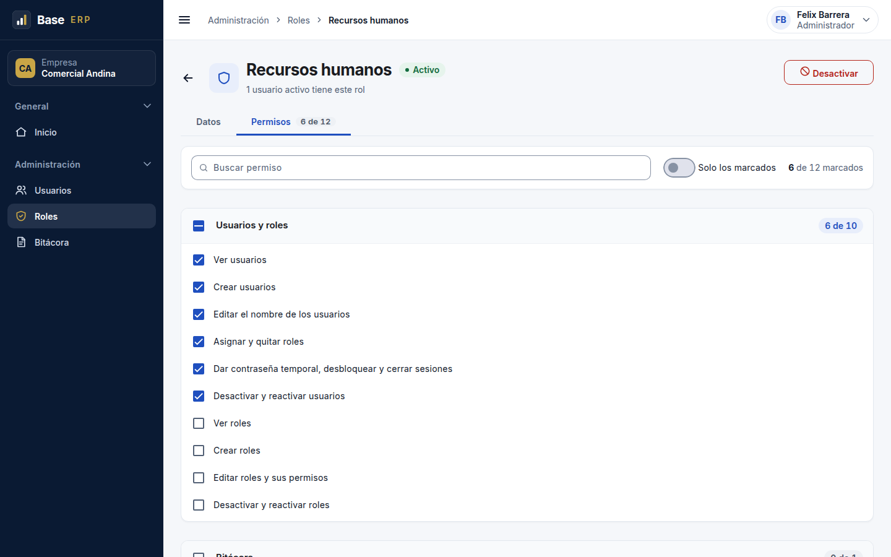 **Role permissions** — grouped by module, pending-changes bar |
| 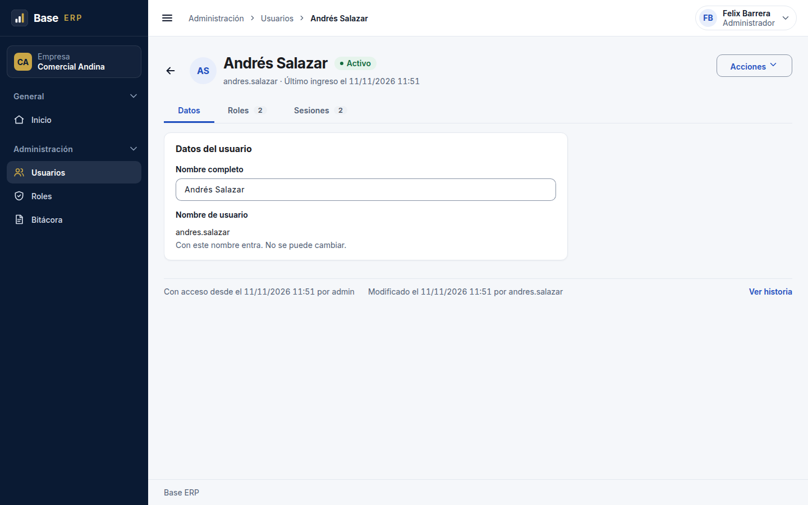 **User detail** — roles, active sessions, "created / modified" footer from the audit log | 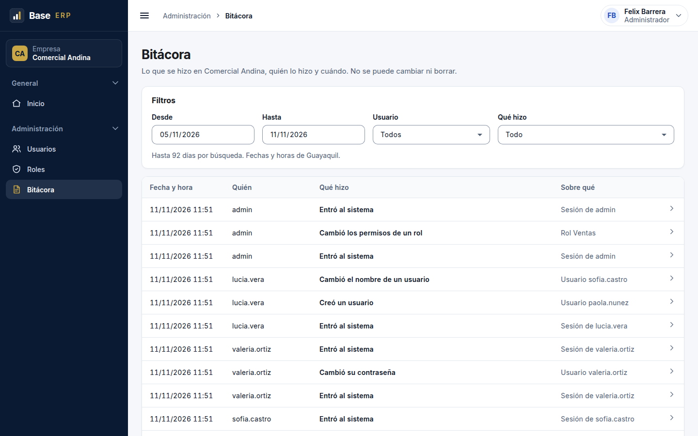 **Audit log** — who did what and when, filterable, read-only |
| 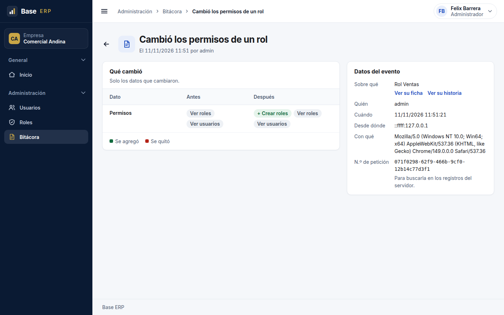 **Audit event** — only the fields that changed, before / after | <p align="center">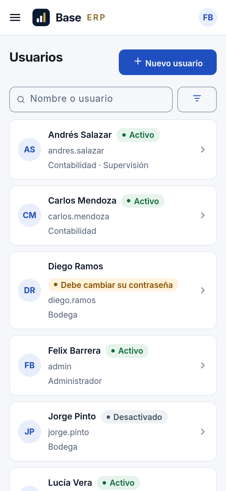 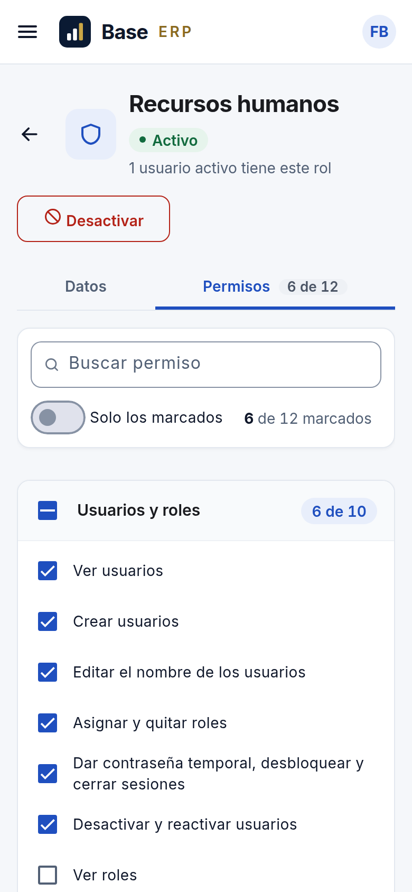</p> **Responsive / PWA** — cards on phones, installable |

---

## Highlights

| Area | What is already solved |
|---|---|
| **Architecture** | Hexagonal layers per module (domain / application / infrastructure), ports injected by token, dependency rules enforced by `oxlint` |
| **Multi-tenancy** | Several companies in one database, data isolated per company; active company carried in the session |
| **Auth** | Short-lived access token in memory + rotating refresh token in an `httpOnly` cookie, CSRF origin guard, Argon2 hashing, password policy (common-password list, user/company names), temporary passwords |
| **Authorization** | Permission per endpoint (`module.resource.action`); every route must declare exactly one access rule or the API refuses to boot; anti-privilege-escalation rules; no super-user |
| **Audit trail** | Every change recorded in the **same transaction**, in a table the application user cannot update or delete; only changed fields stored, sensitive values masked |
| **Data integrity** | UUID v7 ids, `timestamptz` everywhere, money as `Decimal` / a `Money` value object (never `number`), business time zone independent of server and browser |
| **API contract** | Uniform `{ success, data, message }` envelope, global exception filter mapping domain errors, `class-validator` on every input, Swagger/OpenAPI |
| **Operations** | Structured logs with request id (pino), Redis-backed rate limiting, health checks, environment validated at startup |
| **Frontend** | Angular Signals, standalone components, lazy routes, permission guards and directives, URL-driven list filters and pagination, offline-capable PWA |
| **Deployment** | One API image for all clients, one container + one database per client behind Nginx (subdomain routing), automated backups, encrypted off-site copies and restore drills |
| **Quality** | 185 unit test files + 25 e2e suites against a dedicated database, coverage thresholds (80 % on use cases), CI on every PR |

---

## Architecture

### Hexagonal layers

Each module, backend and frontend alike, has the same three layers. Outer layers depend on inner ones; the
domain depends on nothing.

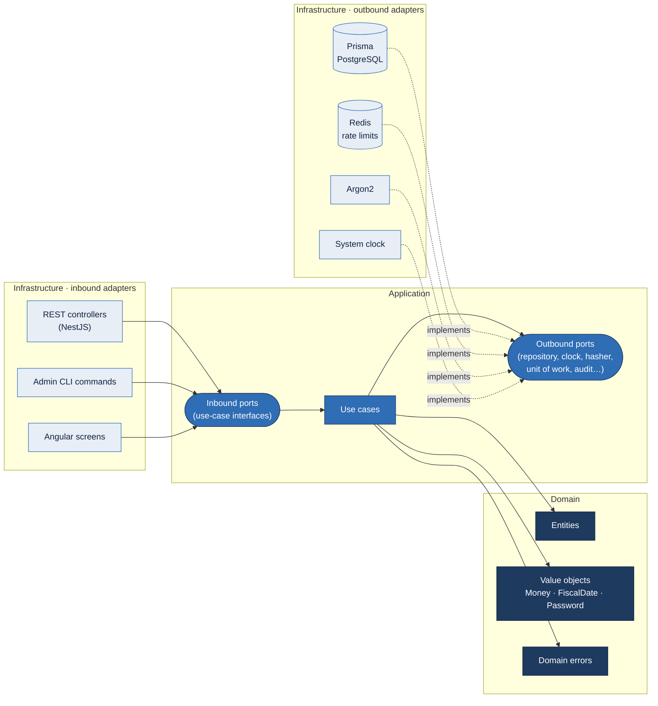

| Layer | Contains | May import |
|---|---|---|
| `domain/` | Entities, value objects, domain errors — pure TypeScript | Its own domain and `shared/domain/` |
| `application/` | Use cases and **ports** (interfaces the use case needs) | Its domain, `shared/`, inbound ports of other modules |
| `infrastructure/` | **Adapters**: controllers, screens, Prisma repositories, HTTP clients, queues | Everything above plus libraries |

Ports are bound with an injection token (`Symbol` in NestJS, `InjectionToken` in Angular), so use cases are
tested with in-memory fakes and no framework. **Breaking a layer rule fails `pnpm lint`.**

### Request flow

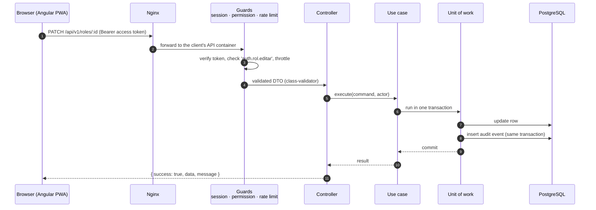

### Repository layout

```
.
├── apps/
│   ├── base-backend/          NestJS API
│   │   ├── prisma/            schema split per module, SQL-reviewed migrations
│   │   ├── src/
│   │   │   ├── modules/       health · empresas (companies) · auth · auditoria (audit)
│   │   │   ├── shared/        clock, money, fiscal date, transactions, logging, HTTP envelope…
│   │   │   └── comandos/      admin CLI entry points
│   │   └── test/              e2e suites (own database, created and migrated automatically)
│   └── base-frontend/         Angular PWA, same module/layer layout
├── despliegue/                Docker images, Nginx, per-client compose files and ops scripts
├── docs/                      architecture, data model, module designs, mandatory rules
├── docker-compose.yml         local PostgreSQL + Redis
└── nuevo-proyecto.sh          turns the template into a new, renamed project
```

---

## Tech stack

| Layer | Technology |
|---|---|
| Language | **TypeScript 6** (strict, ESM, `any` forbidden) |
| Backend | **NestJS 12**, `class-validator`, `@nestjs/swagger`, `@nestjs/throttler`, `nestjs-pino`, `nestjs-cls` (transactions), `@nestjs/jwt` + `@node-rs/argon2` |
| Persistence | **Prisma ORM 7** with `@prisma/adapter-pg`, **PostgreSQL 18** |
| Cache | **Redis 7** (rate limiting) |
| Frontend | **Angular 21** (Signals, standalone), Angular Material & CDK, Service Worker (PWA), SCSS |
| Testing | Vitest 4 (SWC / jsdom), Supertest, coverage thresholds |
| Tooling | pnpm workspaces, `oxlint --type-aware`, GitHub Actions, Dependabot (pre-configured) |
| Infrastructure | **Docker** & Docker Compose, Nginx, restic (encrypted off-site backups) |

---

## Getting started

### Requirements

- Node **24.21.0** (see `.nvmrc`) and **pnpm 12.10.1** — npm and yarn are blocked on purpose
- Docker with Compose
- `openssl` (to generate secrets)

### 1. Clone and install

```bash
git clone https://github.com/<your-user>/<this-repo>.git
cd <this-repo>
nvm use                      # or install Node 24.21.0 another way
corepack enable              # provides the pinned pnpm version
pnpm install
```

### 2. Configure the environment

```bash
cp .env.example .env                                         # Docker: database and Redis ports
cp apps/base-backend/.env.example apps/base-backend/.env     # API settings
```

In `apps/base-backend/.env`, set at least:

```bash
JWT_SECRETO=<output of: openssl rand -base64 64 | tr -d '\n'>   # 64+ characters
EMPRESA_INICIAL_NOMBRE="Demo Company"
ADMIN_INICIAL_USUARIO=admin
ADMIN_INICIAL_NOMBRE="Demo Administrator"
ADMIN_INICIAL_CONTRASENA=<a strong password>
```

Every variable is validated at startup with a clear error message; `.env` files are git-ignored.

### 3. Start PostgreSQL and Redis

```bash
docker compose up -d         # PostgreSQL on 127.0.0.1:5433, Redis on 127.0.0.1:6380
```

### 4. Run the development migrations

```bash
pnpm --filter base-backend exec prisma migrate dev
pnpm --filter base-backend exec prisma generate   # Prisma 7 no longer generates on migrate
```

### 5. Create the first company and administrator

```bash
pnpm build
pnpm admin:crear-inicial     # reads ADMIN_INICIAL_* from the .env
```

Then remove `ADMIN_INICIAL_CONTRASENA` from the `.env`.

### 6. Run

```bash
pnpm dev:backend             # API      → http://localhost:3000/api
pnpm dev:frontend            # Web app  → http://localhost:4200 (proxies /api)
```

- API docs (non-production only): http://localhost:3000/api/v1/docs
- Health check: `curl -s http://localhost:3000/api/v1/health`

### Quality gates

```bash
pnpm lint                                        # layer rules + type-aware lint
pnpm --filter base-backend exec tsc --noEmit
pnpm test                                        # unit tests, backend and frontend
pnpm test:e2e                                    # e2e against a dedicated <db>_test database
pnpm --filter base-backend test:cov              # fails below the coverage thresholds
```

### Starting a new product from this core

`./nuevo-proyecto.sh` asks for the product name, short name and local ports, renames packages, folders and
images, writes both `.env` files with fresh secrets, runs install, lint, type-check, tests and build, and then
removes itself.

---

## Conventions

- **Spanish domain language.** Identifiers are Spanish without accents (`crearRol`, `FechaFiscal`); only
  architecture suffixes and universal technical terms stay in English.
- **No business logic** in controllers or components; **no infrastructure** in use cases.
- **Time comes from a port** (`RELOJ_PORT`), never `new Date()`; business dates live in the configured
  `ZONA_NEGOCIO` time zone regardless of where the server runs.
- **Money is never a `number`.**
- **Masters are deactivated, never deleted**; audit records cannot be modified.
- Full rule set: `docs/reglas-obligatorias.md`. Architecture: `docs/arquitectura-backend.md` and
  `docs/arquitectura-frontend.md`. Data model: `docs/modelo-datos.md`.

---

## License

**Copyright © 2026. All rights reserved.** This repository is published for **evaluation and portfolio
purposes only**. No license is granted to use, copy, modify or distribute the code; see [`LICENSE`](LICENSE).
For commercial use, please get in touch.
